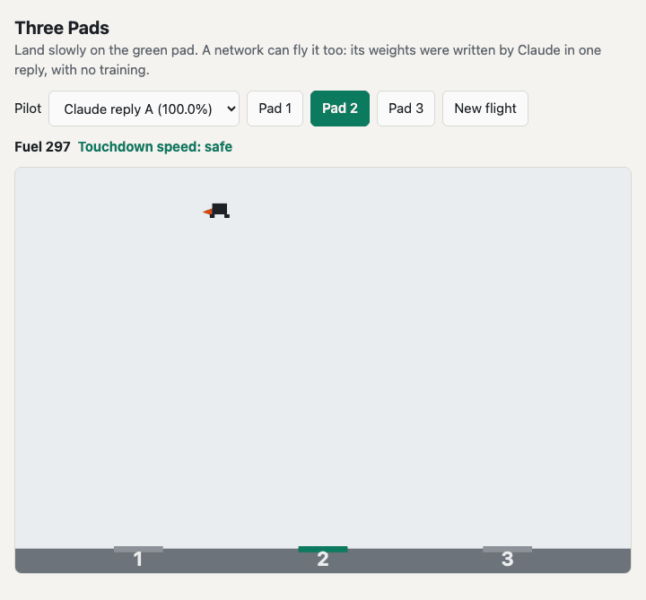

# Weight-Space Programming

Tests one claim, mainly on Claude: an LLM can read and write neural network weights with no training.
Source: [Sparks of Weight-Space Programming](https://rikiyat.github.io/blog/weight-space-programming/) (Takehi et al., 2026).



*Three Pads, an original landing game. The pilot is a 484-weight network that Claude wrote in one reply, with no tools, no feedback and no training. In the last flight, the target changes from pad 1 to pad 3 in flight. Shown at 2x speed. Rebuild with `.venv/bin/python docs/capture.py --gif`.*

**[Play Three Pads](https://mraad.github.io/weight-space-programming/lander/) · [Read the manual](https://mraad.github.io/weight-space-programming/docs/)**

The manual has the method, all results, every procedure and the limits.

| Test | Result |
|---|---|
| Name the game from raw weights (Breakout) | Correct, 93% confidence |
| Same, W1 rows shuffled (control) | Claude found the shuffle. Correct, 60% confidence |
| Write a Breakout network, one reply | 269.4 ± 7.4 (PPO 500M: 25.3, GPT-6 Astra: 517.4) |
| Three Pads, three replies | Each landed 3,000 of 3,000 flights, with a fixed pad and with a pad change |
| Three Pads, low start fuel | All pilots fail. No network reads the fuel input |

## Tank detection experiment

The project also tried the method on a real image task: find circular storage tanks. It did not give a useful detector. A zero-shot detector found 23 of 28 test tanks with 2 false objects, and a network trained on the image gave the best outlines. The LLM repair and the networks that Claude and GPT-6 Astra wrote from zeros did not show a practical gain over plain fixes.

> This experiment did not go as I would like, but that is okay. Not everything has to be a success. We learn from our failures.

Manual section 12 has the method, all results, every failure and its lesson. The images are private and are not in this repo.

## Quick start

```sh
uv sync
.venv/bin/python wsp.py fetch
.venv/bin/playwright install chromium   # only for the browser test
open lander/index.html
```

Three Pads is an original game for this project. The page needs no server.

## Tests

```sh
node --test lander/test.js
.venv/bin/python -m unittest discover -s tests
.venv/bin/python tests/e2e_lander.py
.venv/bin/python wsp.py verify   # no LLM: reproduces the authors' published scores
```

## References

- Takehi, Teoh, Zhang and Khattab. [Sparks of Weight-Space Programming](https://rikiyat.github.io/blog/weight-space-programming/), 2026. [Logs](https://github.com/RikiyaT/lm_understand-logs/tree/4d09ba6d6a7e891dd8063974dfe81b3d78e3494f).
- Singh. [Weight-Space Programming from scratch on simple tasks](https://csinva.io/weight-space-programming-autoresearch/analyze/toy_examples/report.html), 2026. [Code](https://github.com/csinva/weight-space-programming-autoresearch).
- Young and Tian. [MinAtar](https://arxiv.org/abs/1903.03176), 2019.

Manual section 15 lists all 84 references. `python3 docs/check_refs.py` checks each one against its source and writes `docs/references-check.json`.

## License

Code is [MIT](LICENSE). `docs/`, `results/` and `lander/prompt.md` are CC BY 4.0. MinAtar, which the project imports but does not include, is GPL-3.0. [`NOTICE`](NOTICE) gives the details and the attribution.

## Layout

- `wsp.py`: fetch data, call the LLM with no tools, parse replies, score, verify, export.
- `lander/`: the game (`sim.js`), pilots and scoring (`policy.js`), prompt, page.
- `geo/`: the tank detection experiment. See `geo/README.md`.
- `docs/`: the manual. `node docs/build.js` rebuilds it from the run files and `docs/tanks.json`.
- `results/`: one folder per LLM call. `data/`: fetched at runtime, not committed (GPL-3.0 and CC BY 4.0 content).
